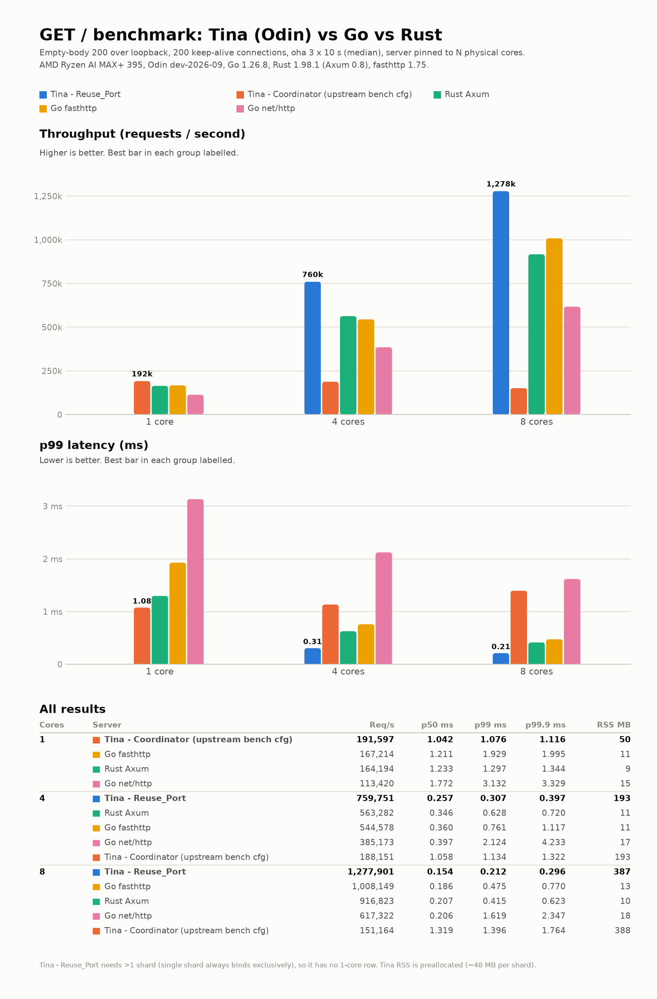

# GET / benchmark: Tina (Odin) vs Go net/http vs Go fasthttp vs Rust Axum



<!-- RESULTS:START (generated by readme_table.py) -->
### Full results

Median of 3 × 10 s runs per cell; `oha` with 200 keep-alive connections; "vs Go net/http" is the ratio at the same core count.
Best server per core count in **bold**. Across all runs, 211,830,241 responses were received and 0 were not `200`.
(oha also reports ~199 requests per run as "aborted due to deadline": in-flight requests cut off when the timer ends, identical for every server.)

| Cores | Server | Req/s (median) | Runs (k req/s) | vs Go net/http | p50 ms | p99 ms | p99.9 ms | RSS MB |
|---:|---|---:|---|---:|---:|---:|---:|---:|
| 1 | **Tina `.Coordinator`** | **191,597** | 192 / 193 / 191 | 1.69x | 1.042 | 1.076 | 1.116 | 50 |
|  | Go fasthttp 1.75 | 167,214 | 167 / 167 / 168 | 1.47x | 1.211 | 1.929 | 1.995 | 11 |
|  | Rust Axum 0.8 | 164,194 | 165 / 164 / 164 | 1.45x | 1.233 | 1.297 | 1.344 | 9 |
|  | Go net/http | 113,420 | 114 / 113 / 113 | 1.00x | 1.772 | 3.132 | 3.329 | 15 |
| 4 | **Tina `.Reuse_Port`** | **759,751** | 757 / 760 / 775 | 1.97x | 0.257 | 0.307 | 0.397 | 193 |
|  | Rust Axum 0.8 | 563,282 | 563 / 559 / 564 | 1.46x | 0.346 | 0.628 | 0.720 | 11 |
|  | Go fasthttp 1.75 | 544,578 | 545 / 541 / 545 | 1.41x | 0.360 | 0.761 | 1.117 | 11 |
|  | Go net/http | 385,173 | 390 / 385 / 381 | 1.00x | 0.397 | 2.124 | 4.233 | 17 |
|  | Tina `.Coordinator` | 188,151 | 191 / 188 / 188 | 0.49x | 1.058 | 1.134 | 1.322 | 193 |
| 8 | **Tina `.Reuse_Port`** | **1,277,901** | 1281 / 1276 / 1278 | 2.07x | 0.154 | 0.212 | 0.296 | 387 |
|  | Go fasthttp 1.75 | 1,008,149 | 1005 / 1010 / 1008 | 1.63x | 0.186 | 0.475 | 0.770 | 13 |
|  | Rust Axum 0.8 | 916,823 | 925 / 917 / 915 | 1.49x | 0.207 | 0.415 | 0.623 | 10 |
|  | Go net/http | 617,322 | 615 / 618 / 617 | 1.00x | 0.206 | 1.619 | 2.347 | 18 |
|  | Tina `.Coordinator` | 151,164 | 151 / 151 / 151 | 0.24x | 1.319 | 1.396 | 1.764 | 388 |

### Scaling

| Server | 1 core | 4 cores | 8 cores | Speed-up 1→4 | Speed-up 1→8 | Req/s per core at 8 |
|---|---:|---:|---:|---:|---:|---:|
| Tina `.Reuse_Port` | 191,597* | 759,751 | 1,277,901 | 3.97x | 6.67x | 159,738 |
| Tina `.Coordinator` | 191,597 | 188,151 | 151,164 | 0.98x | 0.79x | 18,896 |
| Go fasthttp 1.75 | 167,214 | 544,578 | 1,008,149 | 3.26x | 6.03x | 126,019 |
| Rust Axum 0.8 | 164,194 | 563,282 | 916,823 | 3.43x | 5.58x | 114,603 |
| Go net/http | 113,420 | 385,173 | 617,322 | 3.40x | 5.44x | 77,165 |

\* Tina `.Reuse_Port` needs more than one shard, so it has no 1-core run; the speed-up is relative to the single-shard Tina server
(identical code path at 1 shard).
<!-- RESULTS:END -->

## Reproduce

```bash
git clone --recurse-submodules git@github.com:rm4n0s/bench_rust_go_odin_on_http_get_ok.git && cd bench_rust_go_odin_on_http_get_ok
# (tina/ is a submodule pinned to the commit that was benchmarked)

(cd gonet  && go build -o ../bin_go .)
(cd gofast && go build -o ../bin_gofast .)
(cd axum   && cargo build --release) && cp axum/target/release/axum-bench bin_axum
odin build tina_coordinator -o:speed -out:bin_tina_coordinator   # Odin links with `clang`
odin build tina_reuseport   -o:speed -out:bin_tina_reuseport

cargo install oha            # load generator
./run_bench.sh && python3 summarize.py > results/summary.txt
python3 make_chart.py && python3 readme_table.py   # image + README tables (make_chart.py needs matplotlib)
```

`run_bench.sh` pins to cores 0..N-1 (server) and 8-15,24-31 (oha); adjust `LOADCPUS` / `CORES` for a different CPU layout.

## Layout

- `tina_coordinator/` Tina HTTP, `.Coordinator` ingress (the upstream bench config); `tina_reuseport/` same app with `.Reuse_Port` ingress.
  Both are copies of upstream `tina/examples/http_server_for_bench.odin` and import the framework from `tina/` (clone of github.com/pmbanugo/tina, untouched).
- `gonet/` Go 1.26 `net/http` ServeMux, `gofast/` fasthttp 1.75, `axum/` Axum 0.8 + Tokio (release, fat LTO)
- Build: `odin build tina_coordinator -o:speed -out:bin_tina_coordinator` (same for `tina_reuseport`; bounds checks on); Odin needs `clang` to link, a shim script exec'ing gcc was put on PATH.
- Method: server pinned to physical cores 0..N-1, oha pinned to cores 8-15,24-31; 200 keep-alive conns, 3 s warmup + 3x10 s; loopback.
- N workers: Tina N shards, Go/fasthttp GOMAXPROCS=N, Tokio TOKIO_WORKER_THREADS=N.

Table: `results/summary.txt`. Image: `python3 make_chart.py` (needs matplotlib) -> `results/benchmark.png`.
